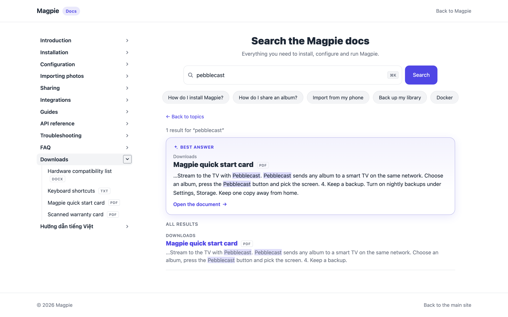
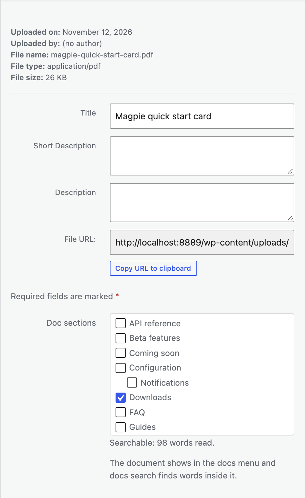

# Search inside PDF and Word files (Waypost Pro)

Manuals, spec sheets and guides often live in files rather than pages. With the Waypost Pro add-on installed, Waypost can put them in your docs: they appear in the menu with a file type label, and docs search finds words inside them.

## Readable file types

PDF, Word (.docx), PowerPoint (.pptx), Excel (.xlsx), OpenDocument (.odt, .odp, .ods), plain text (.txt) and CSV.

Older Office formats (.doc, .xls, .ppt) cannot be read. Open them and save as PDF or the newer format first.

## Add a document

1. Upload the file under **Media, Add New**, as usual.
2. Open it in the **Media Library**.
3. Under **Doc sections**, tick one or more sections. It saves straight away.

To add several files at once, go to **Waypost, Structure, Assign pages**, choose the **Documents** filter, tick the files, choose a section and press **Add to section**.

Uploading a file on its own does not add it to your docs. It joins only when it has at least one section.

## How the text is read

Waypost reads a document's text once, when it joins a section or is edited, and keeps a plain copy for search. Small files are read straight away; larger ones are read in the background within a minute or two. The file's caption and description are searchable too.

**Waypost, Settings, Documents** shows how many documents are searchable and lists any that could not be read, with the reason. **Read waiting documents now** skips the wait, and **Read all documents again** starts afresh.

## Things to know

- **Scanned PDFs** contain pictures of text, not text, so there is nothing to read. Write a short description of the file in the Media Library and search will find that.
- **Password-protected files** cannot be read. Remove the password and upload the file again.
- **Very large files** over 30 MB are skipped, and only the first 500,000 characters of a document are kept.
- A result for a document opens the file itself. Documents are not part of previous and next links or breadcrumbs.
- Anyone with the file's link can download it, as with any WordPress upload. Waypost does not change who can see files.

## Settings

In **Waypost, Settings, Documents**:

- **Let documents join doc sections and search inside them** turns the feature on or off.
- **List documents in the docs menu, under their sections** controls whether they appear in the menu. They stay searchable either way.
